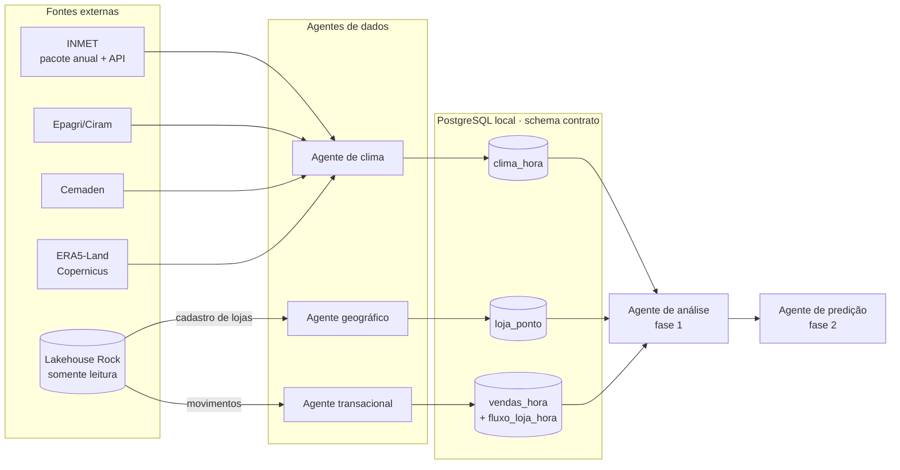

# Arquitetura

Os agentes de dados são os únicos que falam com fontes externas. O agente de análise lê só as
tabelas do schema `contrato`, o que permite trocar uma fonte sem mexer no modelo.

## Contrato de dados

| Tabela | Escreve | Chave | Observações |
| --- | --- | --- | --- |
| `contrato.clima_hora` | agente de clima | id_ponto, data_hora_utc, fonte | UTC + hora local; radiação em W/m²; chuva = acumulado da hora que termina em H; `flag_qualidade` marca, não descarta |
| `contrato.loja_ponto` | agente geográfico | idvarejista, idloja, variavel, data_inicio | um ponto por variável (ex.: chuva do Cemaden, radiação do ERA5-Land) |
| `contrato.vendas_hora` | agente transacional | idvarejista, idloja, data_hora_local, idproduto | soma de quantidade, valor e desconto; cupons distintos |
| `contrato.fluxo_loja_hora` | agente transacional | idvarejista, idloja, data_hora_local | cupons e ticket médio da loja (não somáveis a partir de vendas_hora) |

Tabelas de apoio (`apoio.*`): `ponto_climatico`, `loja`, `produto`, `evento_loja`.

## Regras que valem para todas as fontes

- **Chave da loja:** `idvarejista + idloja` (o ID se repete entre Rede TOP e Preceiro).
- **Fuso:** gravar em UTC e derivar `America/Sao_Paulo` (UTC-3) para o cruzamento com vendas.
- **Fonte e versão:** todo registro guarda `fonte` e `versao_fonte`; o modelo da grade é fixado.
- **Hierarquia:** INMET/Epagri (observação local) → Cemaden (chuva, se mais perto) → ERA5-Land (lacunas).
- **Validação cruzada:** GPM IMERG (chuva), NASA POWER (radiação), NOAA ISD (aeroportos).
- **Nuvem:** o banco de clima tem a mesma estrutura local e na nuvem; migrar = trocar `CLIMA_DB_URL`.

## Decisões tomadas na estruturação (a validar)

- `loja_ponto` ganhou a coluna `variavel`, porque a seção 16 prevê pontos diferentes por variável.
- `fluxo_loja_hora` é gravada pelo agente transacional junto com `vendas_hora`.
- Raio de 15 km para preferir uma estação à grade no agente geográfico (só 5 lojas ficam a até
  15 km de uma estação INMET).
- Colunas do INMET fora do contrato (orvalho, pressão máx./mín., umidade máx./mín.) são lidas
  mas não gravadas em `clima_hora`.
